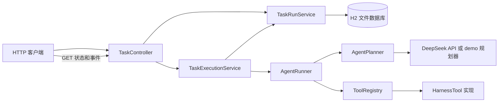

# Spring Agent Harness

一个用 Spring Boot 实现的轻量 Agent Harness 学习项目。它接收任务、异步运行 Agent、按名称调用已注册工具，并提供任务状态和执行事件查询。设计参考 [DeepSeek Harness](https://github.com/deepseek-ai/deepseek-harness) 的工具扩展思路；这是独立的 Java 学习版，不是其源码移植。

## 已实现

- `POST /api/harness/runs`：校验任务描述，返回 `202` 和 `runId`。
- `GET /api/harness/runs/{runId}`：查询 `ACCEPTED → RUNNING → SUCCEEDED/FAILED` 状态及结果。
- `GET /api/harness/runs/{runId}/events`：查询接收、运行、工具调用、工具返回和结束事件。
- H2 文件数据库保存任务与事件；服务重启后仍可查询，未完成任务会被标记为 `FAILED` 并记录中断事件。
- `AgentRunner`：循环调用规划器与工具，最多允许 3 次工具调用，避免无限循环。
- `ToolRegistry`：Spring 自动收集实现 `HarnessTool` 的组件，按名称注册；DeepSeek 请求中的工具说明由注册表生成。
- 两种运行模式：默认使用 DeepSeek API；`demo` 模式使用固定规划器，不需要 API Key。
- 离线测试覆盖异步 HTTP 流程、工具调用、失败分支和 DeepSeek 请求/响应映射。

## 运行环境

JDK 21 或更新版本。项目自带 Maven Wrapper，因此不需要单独安装 Maven；目前不需要 Docker。下面的命令都在 `harness-server` 目录运行。

```powershell
cd D:\codex\2026-10-16\qin\spring-agent-harness\harness-server
.\mvnw.cmd test
```

### 演示模式（推荐先运行）

在第一个 PowerShell 终端启动服务：

```powershell
$env:SPRING_PROFILES_ACTIVE = "demo"
.\mvnw.cmd spring-boot:run
```

保持该终端运行。在第二个终端提交任务：

```powershell
$body = @{ prompt = "INFO started`nERROR A`nERROR B" } | ConvertTo-Json
$created = Invoke-RestMethod -Uri "http://localhost:8080/api/harness/runs" -Method Post -ContentType "application/json" -Body $body
$created
Invoke-RestMethod -Uri "http://localhost:8080/api/harness/runs/$($created.runId)" -Method Get
Invoke-RestMethod -Uri "http://localhost:8080/api/harness/runs/$($created.runId)/events" -Method Get
```

提交响应中的状态固定为 `ACCEPTED`，表示服务器已经接收任务；后台执行完成后，GET 会返回 `SUCCEEDED` 和结果。因为演示模式执行很快，第一次 GET 也可能已经看到最终状态。

按 `Ctrl+C` 停止服务再启动，仍可用同一个 `runId` 查询任务。数据库默认保存在 `harness-server/harness-db.mv.db`，已被 Git 忽略。若想把数据库放到其他位置，可设置 `HARNESS_DB_URL`，例如 `jdbc:h2:file:D:/my-data/harness`；目标目录需要预先存在。

### DeepSeek 模式

在 `harness-server` 下复制示例配置为 `.env`，填入自己的密钥。`.env` 已被 Git 忽略，不要把密钥粘贴到聊天或提交到仓库。

```powershell
Copy-Item .env.example .env
# 在 VS Code 中编辑 .env，替换示例值
Remove-Item Env:SPRING_PROFILES_ACTIVE -ErrorAction SilentlyContinue
.\mvnw.cmd spring-boot:run
```

默认模式通过 DeepSeek 的 `/chat/completions` 接口使用 `deepseek-flash`，并关闭 thinking，以便在下一轮正确提交工具结果。请求设有 5 秒连接超时和 60 秒读取超时。测试套件使用假规划器或假 HTTP 响应，不会消耗 DeepSeek API 额度；真实 API 连通性需要在你配置密钥后手动验证。

## 代码怎么协作



`AgentPlanner` 是接口：默认实现负责调用 DeepSeek，demo 实现返回固定决策。`AgentRunner` 只依赖接口，负责“规划 → 调用工具 → 反馈结果 → 再规划”的循环。`ToolRegistry` 保存工具名到工具对象的映射。Spring 通过依赖注入把这些对象连接起来；`@Async` 让任务执行离开 POST 请求线程。

`DeepSeekModelClient` 是早期的直接模型调用练习；当前任务接口走 `DeepSeekAgentPlanner → AgentRunner` 这条路径。

`TaskRun` 和 `RunEvent` 使用 `record` 表示数据。`TaskRunService` 用 `JdbcTemplate` 读写 H2，并在事务内同时更新状态与写入事件。状态更新会检查原状态，避免把已完成任务错误地改回运行中。服务启动时会把上次中断的 `ACCEPTED` 或 `RUNNING` 任务标记为失败。这里用到了接口、多态、依赖注入、策略模式、异步任务、REST API、JDBC、事务和 JSON 序列化；项目没有自行实现反射框架。

## 当前边界

- 这是使用内嵌文件数据库的单进程服务，不包含分布式任务队列、用户鉴权或 Web 前端；不能把同一个数据库文件当作多实例共享存储。
- 每轮只处理一个工具调用；一个任务最多调用工具 3 次。不执行任意 Shell 命令或文件写入。
- 失败时 API 返回通用错误信息，详细异常记录在服务日志中。
- 默认 API 模式需要你自己的 DeepSeek Key；离线测试通过不能证明真实网络和密钥可用。

如果将来要向生产服务推进，优先增加数据库迁移工具、鉴权、队列容量控制和监控告警。

## 参考

- [DeepSeek Harness 源码](https://github.com/deepseek-ai/deepseek-harness)
- [DeepSeek Tool Calls 文档](https://api-docs.deepseek.com/guides/tool_calls/)
- [Spring Boot 测试文档](https://docs.spring.io/spring-boot/reference/testing/spring-boot-applications.html)
